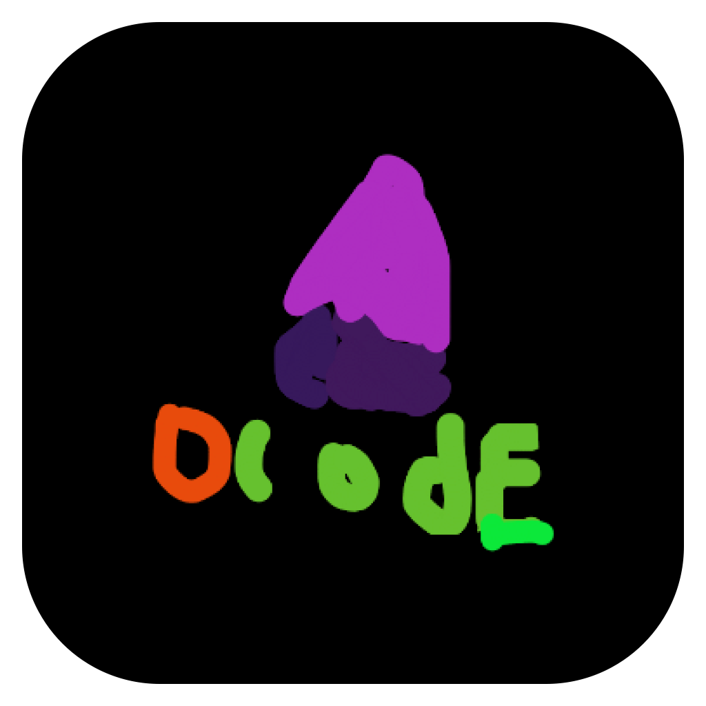

Obsidian doesn't have telemetry, neither should your Agent Orchestrator Harness thingy's Android app.

ObsidianCode is a fork of T3 code with reduced permissions, telemetry, and third-party connections removed. tailscale is added to the app itself so you don't have to worry about running tailscale as the Android app taking up your VPN slot. It's also reduced size by around four because it's only ARM64.

This is for personal use but you can use it.
